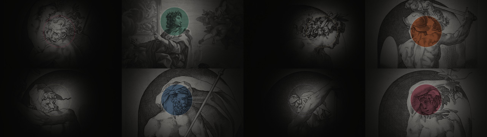
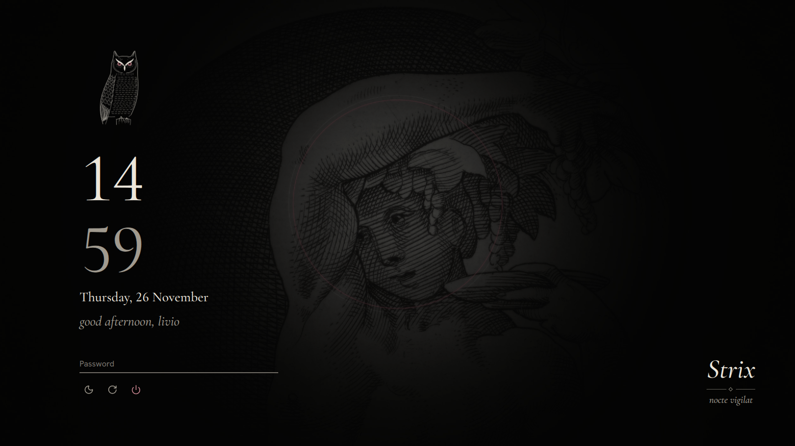
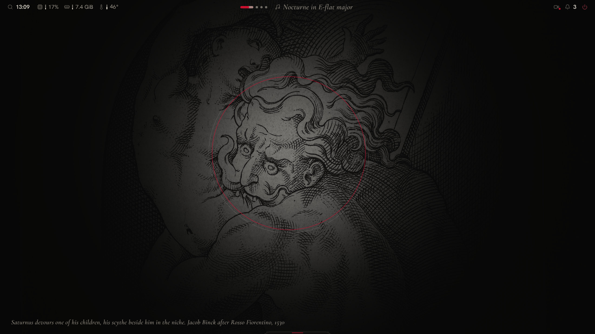
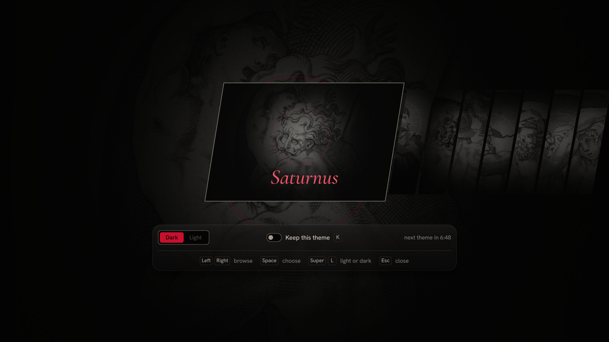
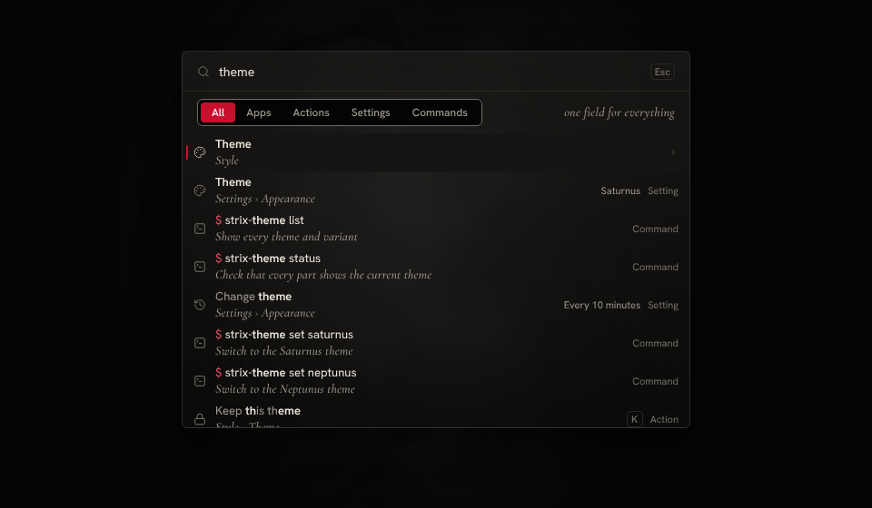
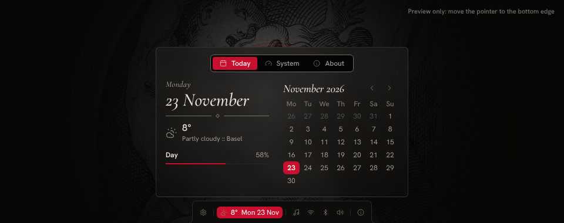
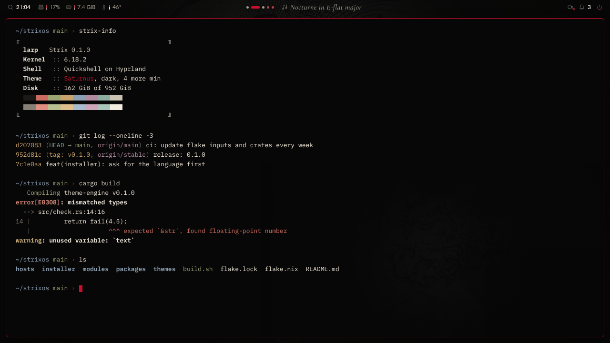
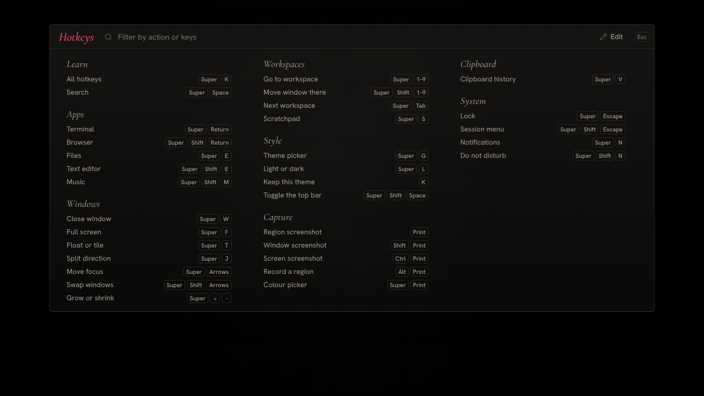
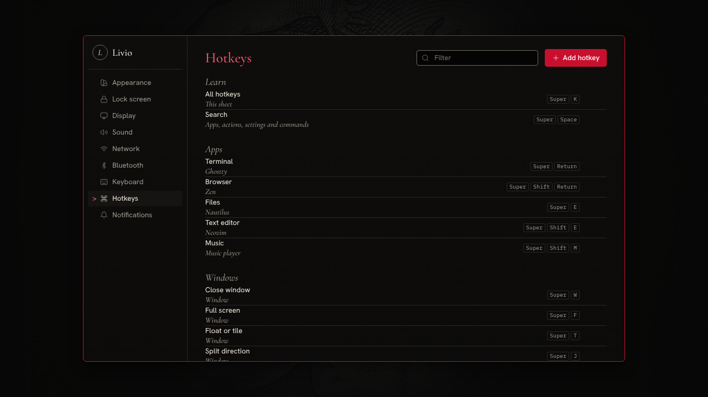
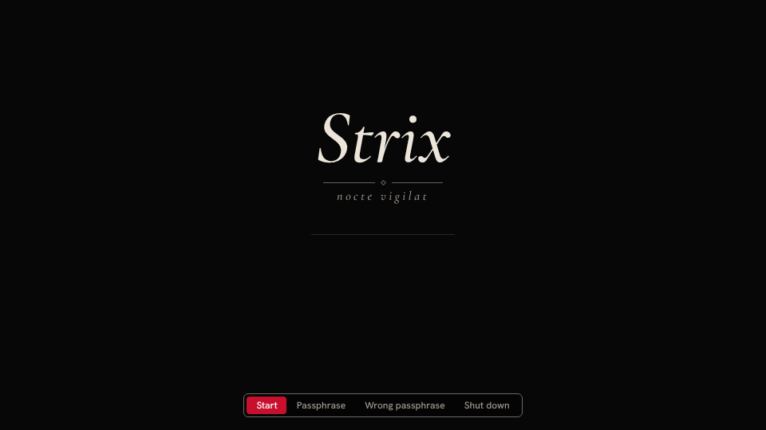

# StrixUI

The design system of Strix: tokens, components, screens and motion for every surface of the system, built for Quickshell (QML) with Rust behind it: the shell and every app of Strix. An HTML bundle of the same components draws the previews. Its default theme is a dark study: near-black surfaces, old engravings of Roman gods as the ground, one accent colour that belongs to the god on the wallpaper, an old-style serif beside a plain grotesque.



This is version 2 of the design. What changed: seven of the eight plates are one series of engravings, printed from the scan at its full resolution in neutral ink and paper, each as a dark and a light plate; the lines and the titles carry the colour of the god; floating surfaces are smoked glass on black; corners are a little rounded; the interface is set in a grotesque, one step larger, with an old-style serif for titles.

Strix has one theme per Roman god: Saturnus (Strix red, the default), Janus, Apollo, Mars, Vulcanus, Neptunus, Pluto and Bacchus. Each theme is a wallpaper and a set of colour tokens that recolours the accent and tints the grounds to match the plate. The theme picker sets both, and the desktop moves on to another god every 10 minutes unless the theme is kept.



The same system is published as a Claude Design System artifact, where every component can be clicked and tried, and every preview follows the theme chosen there: [Strix design system](https://claude.ai/artifact/1hVsjYsQa8J26ydqaEeWZn). Both are built from this repository.

## What is here

| Path | What |
|---|---|
| `design-system/` | The built system. Generated; never edit it by hand. |
| `design-system/README.md` | The brand book: principles, content, colour, type, ornament, space, imagery, symbols, layout of the shell, using the system in code |
| `design-system/motion.md` | Motion tokens, rules, the catalogue of every moving element, and the Hyprland animation block |
| `design-system/surfaces.md` | Which surface uses which stack and takes what; how Quickshell front ends talk to Rust back ends; the HTML of the previews |
| `design-system/tokens.json`, `tokens.css` | Every token: colours (with the terminal colours) in eight themes, one per god, type, spacing, radius, shadow, line, size, duration, easing, opacity |
| `design-system/qml/` | QML module `Strix` for Quickshell (Theme, Icons and 43 components) and `Strix.Shell` (ThemeFile, Backend), the fonts, `gallery.qml` |
| `design-system/rust/strix-design/` | Rust crate for every back end: tokens, the eight themes, the theme cycle and lock rotation, the default hotkeys. No dependencies |
| `design-system/themes/` | One `theme.toml` per god in format 1 of the StrixOS theme engine |
| `design-system/components/` | For the previews and the artifact: `bundle.css` and `bundle.js` (plain HTML with `k-` classes and a small script, `window.Kit`), and for each component and screen a `README.md` (with its QML and HTML use) and a live `preview.html` |
| `design-system/fonts/` | Hanken Grotesk, Cormorant Garamond, IBM Plex Mono (all SIL Open Font License) |
| `design-system/assets/Wallpapers/` | The eight god plates, each dark and light (`<god>.jpg`, `<god>-light.jpg`), and the star chart, with sources and licences |
| `src/` | Sources: `bundle.css`, `bundle.js`, the QML components (`src/qml/`), the hand-written Rust (`src/rust/`), fonts, the Lucide symbols in use (ISC), the wallpapers |
| `src/design/`, `src/components/`, `src/docs/`, `src/templates/` | The data the build reads: gods and their accents, the palette, every other token, the plates, the hotkeys; each component's preview, style and script; the texts; the templates of the generated Rust and QML |
| `tools/` | `strixui`, the tools of the design system in Rust (`cargo strixui` from the repository): build, contrast check, wallpapers, theme repositories, renders; and `artifact.json` |
| `docs/renders/` | Renderings of the screens and of the QML gallery |

## Build

```sh
cargo strixui check                         # contrast of every colour pair and of every god theme, ends with FAILS 0
cargo strixui wallpapers                    # remakes the dark and light plates in src/wallpapers/ (cargo strixui wallpapers mars: one god)
cargo strixui build                         # writes design-system/ and build/preview/
xdg-open build/preview/index.html           # every preview in the browser
cargo strixui render                        # PNG of every preview into build/renders/ (headless Chromium)
cargo strixui render LockScreen --scale 2   # one preview at scale 2
cargo strixui render-qml                    # the QML gallery for every theme into build/renders/, fails on any QML error
(cd design-system/rust/strix-design && cargo test && cargo clippy --all-targets -- -D warnings)
(cd tools && cargo test && cargo clippy --all-targets -- -D warnings)
```

`cargo strixui` is an alias in `.cargo/config.toml` for the `strixui` binary in `tools/`; the build needs only Rust (with `rustfmt` on the path it also formats the generated Rust). `render` needs Chromium or Chrome on the path, or `CHROME` set to one. `render-qml` needs Qt's `qml` tool (Qt 6.8 or newer) on the path or in `QML`; without a display Qt draws in software and shadows and blur are missing. `wallpapers` and `pack` download the engravings with `curl` from the Art Institute of Chicago and the Rijksmuseum into `build/engravings/` the first time.

## Publish to the artifact

```sh
cargo strixui build --artifact build/artifact   # build/artifact/project/... in the layout the artifact expects
```

Then publish `build/artifact/project/` to the artifact listed in `tools/artifact.json`. The wallpapers are uploads there; their ids are in `tools/artifact.json`. A new or changed wallpaper is uploaded first and its id and size are written into that file.

## Use it

- Linux, the shell and every app (Quickshell): put `design-system/qml` on the import path, `import Strix`, and one `ThemeFile {}` from `Strix.Shell` so the colours follow the theme engine. Each component's README has its QML example.
- HTML, the previews: load `tokens.css`, `components/bundle.css` and `components/bundle.js`, write the markup from a component's README, and call `Kit.hydrate(root)`.
- Every back end (Rust): `strix-design = { git = "https://github.com/liviosysctl/strixui" }`.
- StrixOS theme engine: copy `design-system/themes/*` into `themes/` of the strixos repository; `strix-theme check` passes on all eight.
- Themes from outside: a theme repository in layout 1 ([strix-theme-template](https://github.com/liviosysctl/strix-theme-template), the first one is [strix-theme-lucifer](https://github.com/liviosysctl/strix-theme-lucifer)), made with `cargo strixui pack <repository>`.
- Hyprland, Ghostty, Plymouth, the installer: take the values from `tokens.json` or the theme engine; `surfaces.md` says what each one reads.
- The colour names match the theme engine of Strix: the ten required colours of `theme.toml` have the same names, and the `term-` colours map to its `terminal` table.

## Screens

| | |
|---|---|
|  |  |
|  |  |
|  |  |
|  |  |
|  | |

## Not done yet

- The screens in QML: the shell assembles them from the components (each screen's README says with which Quickshell types); the gallery shows the components only.
- A test that compares the QML and HTML renderings pixel by pixel; today they are compared by eye.
- Screens: clipboard history, screenshot tool, greeter, session menu, the other settings pages (Hotkeys is done), text installer, store.
- The search service behind Search (the component and its behaviour are done; the plan is in StrixOS-Plan, `10-search.md`).
- The workspaces as numbers and the blur behind the glass: both belong to the shell and the compositor rules in StrixOS.
- The grain over the wallpaper in QML (HTML has it).
- The Hyprland block in `motion.md` is not yet tested on a real Hyprland.
