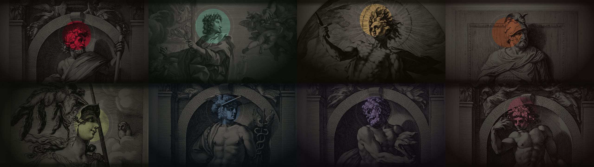
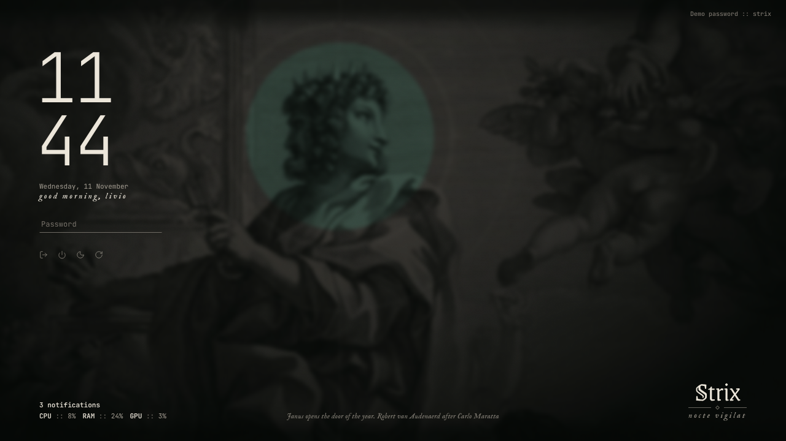
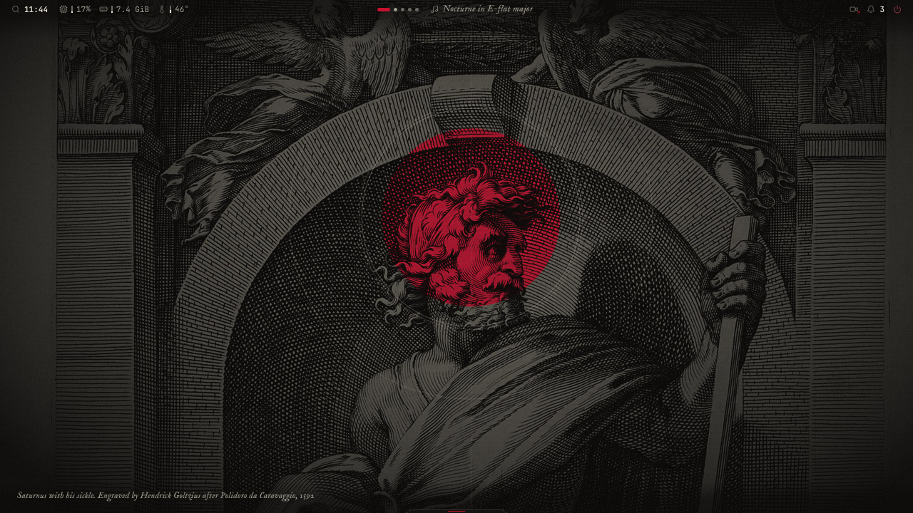
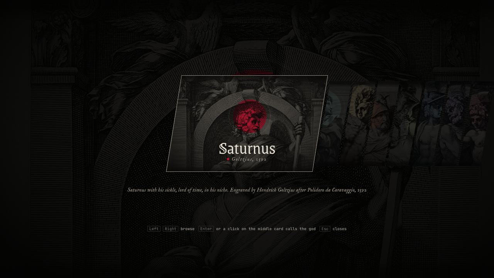
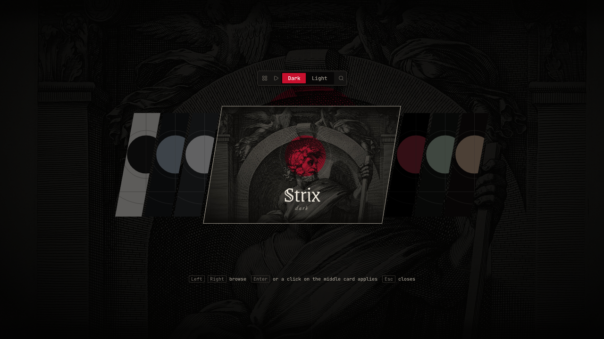
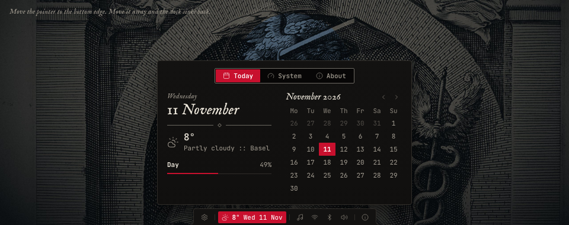
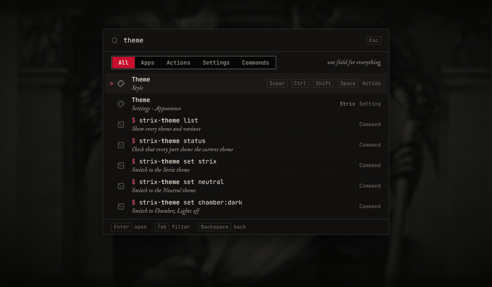
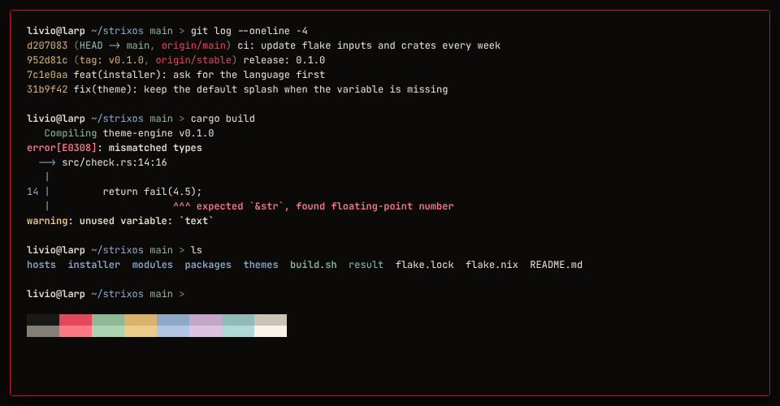
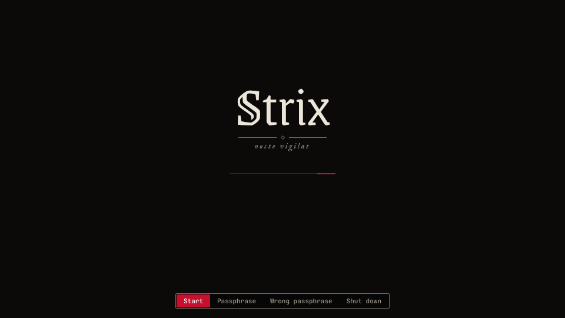

# StrixUI

The design system of Strix: tokens, components, screens and motion for every surface of the system. Its default theme is a dark study: near-black surfaces, old engravings of Roman gods as the ground, one accent colour that belongs to the god on the wallpaper, type from an old printing house beside a quiet monospace.



The default theme has eight gods: Saturnus (Strix red, the default), Janus, Apollo, Mars, Minerva, Mercurius, Pluto and Bacchus. Each is a wallpaper and an aspect, a set of colour tokens that recolours the accent and tints the grounds to match the plate. Choosing a god sets both.



The same system is published as a Claude Design System artifact, where every component can be clicked and tried: [Strix design system](https://claude.ai/artifact/1hVsjYsQa8J26ydqaEeWZn). Both are built from this repository.

## What is here

| Path | What |
|---|---|
| `design-system/` | The built system. Generated; never edit it by hand. |
| `design-system/README.md` | The brand book: principles, content, colour, type, ornament, space, imagery, symbols, layout of the shell |
| `design-system/motion.md` | Motion tokens, rules, the catalogue of every moving element, and the Hyprland animation block |
| `design-system/surfaces.md` | How the shell, the Windows bootstick app, the store, Hyprland, Ghostty, Plymouth and the installer take the system |
| `design-system/tokens.json`, `tokens.css` | Every token: colours (with the terminal colours) in eight aspects, one per god, type, spacing, radius, shadow, line, size, duration, easing, opacity |
| `design-system/components/` | `bundle.css` and `bundle.js` (plain HTML with `k-` classes and a small script, `window.Kit`), and for each component and screen a `README.md` and a live `preview.html` |
| `design-system/fonts/` | JetBrains Mono, IM Fell English, Grenze Gotisch (all SIL Open Font License) |
| `design-system/assets/Wallpapers/` | The eight god plates and the star chart, with sources and licences |
| `src/` | Sources: `bundle.css`, `bundle.js`, fonts, the Lucide symbols in use (ISC), the wallpapers |
| `tools/` | `build.py` (builds the system), `palette.py` (colours and the contrast check), `pantheon.py` (the gods, their aspects and the contrast check of every aspect), `components.py` and `docs.py` (previews and texts), `wallpapers.py`, `render.py`, `artifact.json` |
| `docs/renders/` | Renderings of the screens |

## Build

```sh
python3 tools/palette.py                      # contrast check of every colour pair, ends with FAILS 0
python3 tools/pantheon.py                     # the same for every aspect of the eight gods, ends with FAILS 0
python3 tools/wallpapers.py                   # remakes the eight plates in src/wallpapers/ (python3 tools/wallpapers.py mars: one)
python3 tools/build.py                        # writes design-system/ and build/preview/
xdg-open build/preview/index.html             # every preview in the browser
python3 tools/render.py                       # PNG of every preview into build/renders/ (needs playwright)
python3 tools/render.py LockScreen --scale 2  # one preview at scale 2
```

The build needs only Python 3. `render.py` needs `playwright` with Chromium; set `CHROME` to use an installed Chrome instead. `wallpapers.py` needs Pillow and numpy and downloads the engravings from the Art Institute of Chicago and the Rijksmuseum into `build/engravings/` the first time.

## Publish to the artifact

```sh
python3 tools/build.py --artifact build/artifact   # build/artifact/project/... in the layout the artifact expects
```

Then publish `build/artifact/project/` to the artifact listed in `tools/artifact.json`. The wallpapers are uploads there; their ids are in `tools/artifact.json`. A new or changed wallpaper is uploaded first and its id and size are written into that file.

## Use it

- Web and Tauri (the bootstick app, the store): load `tokens.css`, `components/bundle.css` and `components/bundle.js`, write the markup from a component's README, and call `Kit.hydrate(root)`.
- Quickshell, Hyprland, Ghostty, Plymouth, the installer: take the values from `tokens.json`; keep component names, states and measurements as documented. `surfaces.md` says what each one reads.
- The colour names match the theme engine of Strix: the ten required colours of `theme.toml` have the same names, and the `term-` colours map to its `terminal` table.

## Screens

| | |
|---|---|
|  |  |
|  |  |
|  |  |
|  |  |

## Not done yet

- QML components for Quickshell, a QML gallery, and a test that compares the QML and web renderings.
- Screens: clipboard history, screenshot tool, greeter, session menu, settings, text installer, store, bootstick app.
- The search service behind Search (the component and its behaviour are done; the plan is in StrixOS-Plan, `10-search.md`).
- The light variant.
- The Hyprland block in `motion.md` is not yet tested on a real Hyprland.
